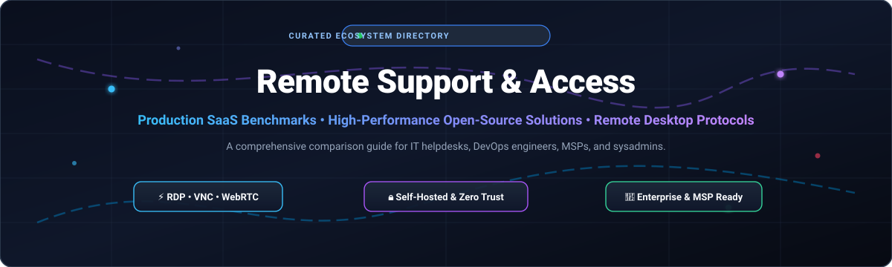

# 🌐 Awesome Remote Support & Access Solutions 🖥️

> 🚀 **The definitive curated list of industry-leading Remote Support, Remote Desktop Access, Screen Sharing, and RMM Platforms.** Featuring in-depth pricing benchmarks, company valuations, market dynamics, and top-tier open-source self-hosted alternatives for IT administrators, sysadmins, DevOps, MSPs, and security teams.

  

---

## 📑 Table of Contents
- [📈 Sector Overview & Market Dynamics](#-sector-overview--market-dynamics)
- [🏢 SaaS & Hosted Commercial Platforms](#-saas--hosted-commercial-platforms)
- [💻 Open-Source & Self-Hosted Solutions](#-open-source--self-hosted-solutions)
  - [1. RustDesk](#1-rustdesk-)
  - [2. Sunshine](#2-sunshine-)
  - [3. Moonlight](#3-moonlight-)
  - [4. noVNC](#4-novnc-)
  - [5. FreeRDP](#5-freerdp-)
  - [6. mRemoteNG](#6-mremoteng-)
  - [7. TigerVNC](#7-tigervnc-)
  - [8. MeshCentral](#8-meshcentral-)
  - [9. xrdp](#9-xrdp-)
  - [10. Apache Guacamole](#10-apache-guacamole-)
  - [11. Remmina](#11-remmina-)
  - [12. Selkies](#12-selkies-)
  - [13. Aspia](#13-aspia-)
  - [14. ScottiBYTE Assist](#14-scottibyte-assist-)
- [⚖️ Architecture & Comparison Matrix](#️-architecture--comparison-matrix)
- [🤝 Contributing Guidelines](#-contributing-guidelines)
- [📄 License](#-license)

---

## 📈 Sector Overview & Market Dynamics

The global remote desktop and remote support software market is valued at approximately **$3.5 billion to $4.2 billion** (projected to exceed **$6.5+ billion** by 2030, registering a Compound Annual Growth Rate of ~13–15%), accelerated by permanent hybrid workforce architectures, cloud migration, and decentralized enterprise IT helpdesks.

The competitive landscape is **moderately concentrated** at the top tier—where established tech conglomerates and private-equity-backed titans (such as Francisco Partners/BeyondTrust, Thoma Bravo/ConnectWise, Zoho, and TeamViewer) command over 50% of enterprise revenues—paired with a vibrant, highly innovative, and fragmented ecosystem of specialized MSP tools and fast-rising, privacy-centric open-source protocols (like RustDesk, Sunshine/Moonlight, and Apache Guacamole) capturing developers and security-conscious self-hosters.

---

## 🏢 SaaS & Hosted Commercial Platforms

Below is a detailed benchmark of leading commercial Remote Support and Access vendors, sorted in descending order by parent company scale (annual revenue / enterprise valuation).

| Platform 🖥️ | Scale / Valuation 💰 | Starting Pricing 🏷️ | Free Tier / Trial Limits ⏳ | Attended / Unattended 🔄 | Primary Focus 🎯 |
|---|---|---|---|---|---|
| **[Zoho Assist](https://www.zoho.com/assist/)** | **$1.1B+ Revenue** (Zoho Corp, bootstrapped profitable SaaS) | **$10/technician/month** (Standard plan, billed annually at $120/yr) | **Free forever plan**: 1 remote technician, 5 unattended computers, clipboard sharing & instant chat; plus **15-day free trial** with full enterprise features | Both (Attended & Unattended) | Budget-friendly IT helpdesk integrated directly into the Zoho CRM/Desk ecosystem |
| **[ConnectWise ScreenConnect](https://www.connectwise.com/platform/remote-access/screenconnect)** | **$1.5B+ Valuation** (Acquired by Thoma Bravo, $240M+ ARR) | **$28/month** (One Plan: 1 concurrent session, 10 unattended access agents) | **Free forever plan**: 1 technician session, 3 unattended access agents; plus **14-day fully featured free trial** | Both (Attended & Unattended) | Managed Service Providers (MSPs), IT service operations, and technician support queues |
| **[BeyondTrust Remote Support](https://www.beyondtrust.com/remote-support)** | **$3B+ Valuation** (Francisco Partners portfolio company) | **$2,097/concurrent license/year** (~$174.75/month billed annually) | **No permanent free tier**; Proof-of-Concept (PoC) enterprise access granted via **7-day to 14-day assisted trial** through sales verification | Both (Attended & Unattended) | Regulated enterprise IT, zero-trust credential injection, compliance auditing, and PAM |
| **[Splashtop](https://www.splashtop.com/)** | **$1B+ Valuation** (Unicorn status, $100M+ ARR) | **$8.25/user/month** (Business Access Solo, billed annually at $99/yr) | **No permanent free tier**; offers a **7-day free trial** (Business Access, up to 2 computers) and a **14-day free trial** for Splashtop SOS (attended support) | Both (Attended & Unattended) | Ultra low-latency remote desktop for creative professionals, 4K video editing, and IT support |
| **[TeamViewer](https://www.teamviewer.com/)** | **€670M+ Revenue** (~$730M ARR / €2.5B+ Market Cap, Frankfurt: TMV) | **$24.90/month** (Single User Remote Access, billed annually at $298.80/yr) | **Free forever for personal, non-commercial use only** (algorithmically restricted: automatically throttles and disconnects sessions upon suspected commercial patterns); **14-day commercial trial** | Both (Attended & Unattended) | Global cross-platform standard for IT enterprise administration and end-user support |
| **[AnyDesk](https://anydesk.com/)** | **$600M+ Valuation** (Funded by EQT & Insight Partners, tens of millions ARR) | **$14.90/month** (Solo Plan: 1 licensed user, 3 login devices, 1 concurrent session, billed annually) | **Free forever for private, non-commercial use only** (capped at single device sessions with periodic reminder screens and usage audits); **14-day free trial** for professional tiers | Both (Attended & Unattended) | Proprietary DeskRT codec delivering lightweight, high frame rate desktop streaming on low bandwidth |

---

## 💻 Open-Source & Self-Hosted Solutions

The open-source remote access ecosystem spans full-stack self-hosted clients, lightning-fast game/desktop streaming servers, browser-based HTML5 gateways, and core remote protocol libraries. 

Repositories are listed in **descending order by GitHub star count**:

### 1. [RustDesk](https://github.com/rustdesk/rustdesk) 
* **Tech Stack:** 🦀 Rust / Flutter / C++ | **License:** AGPL-3.0
* **Overview:** The undisputed open-source frontrunner replacing TeamViewer and AnyDesk. RustDesk operates out-of-the-box using community rendezvous servers or allows deploying complete private relay/signaling servers (`rustdesk-server`) for ultimate data sovereignty.
* **Key Features:**
  * End-to-end encryption based on NaCl (P2P direct connections whenever routable).
  * Native cross-platform clients: Windows, macOS, Linux, Android, iOS, and WebAssembly.
  * Modern video codec pipeline: VP8, VP9, AV1 software codecs and hardware-accelerated H.264/H.265.
  * Native Wayland display server support with multi-monitor scaling on Linux distributions.
  * Attended and unattended access modes without requiring administrative elevation up front.

### 2. [Sunshine](https://github.com/LizardByte/Sunshine) 
* **Tech Stack:** ⚡ C++ / WebUI / NVENC / VAAPI | **License:** GPL-3.0
* **Overview:** A blazing-fast, self-hosted GameStream and desktop host server for Moonlight. Sunshine provides ultra-low latency remote desktop streaming with native support for both AMD, Intel, and Nvidia hardware encoding.
* **Key Features:**
  * High frame rate desktop streaming (60fps to 120fps+ 4K HDR).
  * Web-based configuration management interface and gamepad/mouse/keyboard emulation.
  * Zero reliance on proprietary GPU drivers or Geforce Experience software.
  * Pin-pairing authentication mechanism with strong TLS security.

### 3. [Moonlight](https://github.com/moonlight-stream/moonlight-qt) 
* **Tech Stack:** 🎮 C++ / Qt / SDL2 | **License:** GPL-3.0
* **Overview:** Open-source client implementation of NVIDIA's GameStream protocol (used alongside Sunshine). Recognized as the standard for responsive, near-zero-latency remote desktop interaction and remote workstation rendering.
* **Key Features:**
  * Up to 4K 120 FPS+ streaming with HDR and 5.1/7.1 surround sound pass-through.
  * Minimal input latency across Windows, macOS, Linux, Steam Link, iOS, and Android.
  * Automatic hardware video decoding optimization.

### 4. [noVNC](https://github.com/novnc/noVNC) 
* **Tech Stack:** 🌐 JavaScript / HTML5 Canvas / WebSockets | **License:** MPL-2.0
* **Overview:** An open-source VNC client JavaScript library and web application running directly inside any modern web browser. Used extensively in cloud orchestrators (OpenStack, Proxmox VE, Kubernetes KubeVirt) to deliver clientless console access.
* **Key Features:**
  * 100% clientless execution via HTML5 canvas and WebSockets.
  * Mobile touchscreen emulation and virtual keyboard gesture support.
  * Broad encryption support via encrypted WebSockets (WSS).

### 5. [FreeRDP](https://github.com/FreeRDP/FreeRDP) 
* **Tech Stack:** 🔧 C | **License:** Apache-2.0
* **Overview:** The industry-standard open-source implementation of the Microsoft Remote Desktop Protocol (RDP). It powers dozens of client applications, gateways, virtualization suites, and embedded thin clients worldwide.
* **Key Features:**
  * Complete support for modern RDP specifications, RemoteFX, and RD Gateway servers.
  * Dynamic multi-monitor topology resolution adjustments.
  * Microphone and audio input/output redirection with clipboard integration.

### 6. [mRemoteNG](https://github.com/mRemoteNG/mRemoteNG) 
* **Tech Stack:** 📑 C# / .NET | **License:** GPL-2.0
* **Overview:** A multi-tabbed, multi-protocol remote connections manager for Windows IT system administrators who manage hundreds of active server endpoints.
* **Key Features:**
  * Consolidated UI supporting RDP, VNC, SSH, Telnet, ICA (Citrix), and HTTP/HTTPS.
  * Hierarchical folder structure for grouping corporate servers and credentials.
  * Encrypted credential storage with external SQL database syncing for team environments.

### 7. [TigerVNC](https://github.com/TigerVNC/tigervnc) 
* **Tech Stack:** 🐯 C++ / C | **License:** GPL-2.0
* **Overview:** A high-speed, vendor-neutral open-source VNC implementation focused on high performance, 3D graphics rendering, and enterprise-grade reliability over remote networks.
* **Key Features:**
  * Tight encoding optimizations for high image fidelity and low network bandwidth.
  * Advanced TLS encryption and PAM-based corporate authentication support.
  * Fully integrated X11 VNC server extension (`libvnc.so`).

### 8. [MeshCentral](https://github.com/Ylianst/MeshCentral) 
* **Tech Stack:** 🌐 Node.js / WebSockets / JavaScript | **License:** Apache-2.0
* **Overview:** A complete web-based remote computer management and remote monitoring (RMM) portal. MeshCentral lets sysadmins remotely manage computers on local LANs or over the public internet through a centralized web browser console.
* **Key Features:**
  * Out-of-the-box web-based remote desktop, remote terminal shell, and file transfer explorer.
  * Intel AMT (Active Management Technology) hardware out-of-band management support.
  * Multi-tenant device grouping, granular user permissions, and audit logs.

### 9. [xrdp](https://github.com/neutrinolabs/xrdp) 
* **Tech Stack:** 🐧 C | **License:** GPL-2.0
* **Overview:** An open-source RDP server for Unix-like operating systems. Enables native Windows Remote Desktop Connection (`mstsc.exe`) clients to remotely log into Linux desktop environments (GNOME, XFCE, KDE).
* **Key Features:**
  * Two-way clipboard sharing (text, bitmaps, files).
  * Audio redirection and remote drive mounting.
  * Seamless integration with Xorg and X11rdp display servers.

### 10. [Apache Guacamole](https://github.com/apache/guacamole-server) 
* **Tech Stack:** ☕ Java / C / HTML5 | **License:** Apache-2.0
* **Overview:** The premier clientless HTML5 remote desktop gateway. Guacamole bridges RDP, VNC, and SSH protocols into a web interface requiring zero plugins or client software on the end-user machine.
* **Key Features:**
  * Pure browser-based access—zero software footprint on client devices (ideal for BYOD).
  * Enterprise authentication plugins: LDAP, Active Directory, SAML 2.0, OpenID, Duo MFA.
  * Screen recording, session auditing, and on-demand session sharing for collaborative support.

### 11. [Remmina](https://github.com/FreeRDP/Remmina) 
* **Tech Stack:** 🐧 C / GTK3 | **License:** GPL-2.0
* **Overview:** The most popular multi-protocol remote desktop client for Linux and Unix-like operating systems. Remmina is included as the default remote desktop client on many major Linux distributions.
* **Key Features:**
  * Broad protocol support: RDP, VNC, SPICE, SSH, SFTP, and EXEC.
  * Tabbed connection profiles, viewport scaling, and SSH tunneling.
  * Internationalization with robust plug-in architecture.

### 12. [Selkies](https://github.com/selkies-project/selkies) 
* **Tech Stack:** 🚀 Python / WebRTC / Docker / GStreamer | **License:** MPL-2.0
* **Overview:** A cloud-native, GPU-accelerated WebRTC remote desktop platform built for containers, Kubernetes, and high-performance computing (HPC) streaming.
* **Key Features:**
  * WebRTC ultra-low-latency video delivery directly into modern browsers.
  * Native GPU encoding pass-through for Dockerized desktop and workstation containers.
  * Cloud gaming and engineering CAD workstation streaming over standard web ports.

### 13. [Aspia](https://github.com/dchapyshev/aspia) 
* **Tech Stack:** 💻 C++ / Qt | **License:** GPL-3.0
* **Overview:** A lightweight, high-performance remote desktop management and file transfer system with built-in encryption and address book management.
* **Key Features:**
  * Fast VP8/VP9/WebP-based desktop video encoding engine.
  * Integrated multi-pane file transfer and text messaging.
  * Master password encryption for connection books and router/NAT relay capability.

### 14. [ScottiBYTE Assist](https://github.com/ScottiBYTE/scottibyte-assist) 
* **Tech Stack:** 🤝 Node.js / Docker / WebRTC | **License:** AGPL-3.0
* **Overview:** A consent-first, self-hosted attended remote assistance solution tailored for ad-hoc helpdesk scenarios where unattended background access is strictly prohibited.
* **Key Features:**
  * Ephemeral 6-digit support session codes with explicit end-user click-to-permit dialogs.
  * No persistent background agent or unattended backdoor access by design.
  * Two-way interactive customer terminal and session audit logging.

---

## ⚖️ Architecture & Comparison Matrix

| Project 🛠️ | Type / Category 📂 | License 📜 | Self-Hosted Server 🏠 | Zero-Install Client (Browser) 🌐 | Star Count 🌟 | Best Deployment Scenario 🎯 |
|---|---|---|---|---|---|---|
| **RustDesk** | Remote Control App | AGPL-3.0 | ✅ (OSS & Pro Relay) | ✅ (Web Client) | **129k+** | Direct drop-in replacement for TeamViewer & AnyDesk |
| **Sunshine** | Host Streaming Server | GPL-3.0 | ✅ (Native Daemon) | ❌ (Pairs with Moonlight) | **43k+** | 4K 120fps low-latency desktop/workstation streaming |
| **Moonlight** | Stream Client | GPL-3.0 | ❌ (Client App) | ❌ (Native Client) | **19k+** | Best-in-class low-latency remote display client |
| **noVNC** | Web Gateway / Library | MPL-2.0 | ✅ (Node / Python Proxy) | ✅ (HTML5 Canvas) | **14k+** | Embedding browser-based VNC into web apps & cloud dashboards |
| **FreeRDP** | Protocol Stack / Client | Apache-2.0 | ❌ (Core Library) | ❌ (Native Client) | **14k+** | Building enterprise RDP solutions and Linux client bridges |
| **mRemoteNG** | Connection Manager | GPL-2.0 | ❌ (Desktop Utility) | ❌ (Windows Native) | **11k+** | Tabbed multi-server administration (RDP/SSH/VNC) on Windows |
| **TigerVNC** | VNC Server / Client | GPL-2.0 | ✅ (X11 / VNC Server) | ❌ (Native Viewer) | **7.7k+** | High-performance graphical VNC streaming for Unix workstations |
| **MeshCentral** | Web RMM & Remote Control | Apache-2.0 | ✅ (Node.js Portal) | ✅ (HTML5 Terminal & Canvas) | **7.6k+** | Complete self-hosted device management, RMM, and remote control |
| **xrdp** | RDP Server Daemon | GPL-2.0 | ✅ (Linux Service) | ❌ (Connects via RDP) | **6.7k+** | Letting Windows machines access Linux desktops via native RDP |
| **Apache Guacamole** | Clientless Gateway | Apache-2.0 | ✅ (Guacamole Server) | ✅ (HTML5 Web Interface) | **4.0k+** | Clientless BYOD remote access to corporate RDP/VNC/SSH |
| **Remmina** | Desktop Client | GPL-2.0 | ❌ (Client App) | ❌ (GTK Native) | **2.5k+** | Unified remote desktop client for Linux desktop users |
| **Selkies** | Cloud/WebRTC Streamer | MPL-2.0 | ✅ (Docker / K8s) | ✅ (WebRTC Browser) | **2.5k+** | Streaming containerized GPU desktops over WebRTC |
| **Aspia** | Remote Desktop Suite | GPL-3.0 | ✅ (Host & Router) | ❌ (Native Client) | **1.9k+** | Lightweight standalone desktop control and fast file management |
| **ScottiBYTE Assist** | Attended Support Portal | AGPL-3.0 | ✅ (Docker Compose) | ❌ (Attended Client) | **<100** | Strict consent-only remote customer tech support |

---

## 🤝 Contributing Guidelines

Contributions, suggestions, and corrections are warmly welcomed! 🌟

1. **Fork the repository** and create a feature branch (`git checkout -b feature/new-tool`).
2. Verify that open-source candidates are actively maintained (releases or commits within the past 12 months) and clearly link their official source repository.
3. For commercial SaaS tools, ensure concrete starter pricing and exact free trial / free tier terms are cited.
4. Commit your enhancements (`git commit -m 'Add ToolName to Remote Support list'`) and open a Pull Request.

---

## 📄 License

This collection is released under the **Creative Commons Zero v1.0 Universal ([CC0 1.0](https://creativecommons.org/publicdomain/zero/1.0/))** Public Domain Dedication. Individual linked software and services retain their respective copyrights, licenses, and trademarks.

  Built with ❤️ for the open-source and systems engineering community. If this list helped your workflow, don't forget to ⭐ star the repository!

